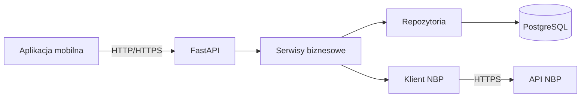

# Backend — Mobilny system wymiany walut

## 1. Temat i zakres odpowiedzialności

Temat projektu: mobilny system wymiany walut.

Zakres tej części projektu obejmuje wyłącznie backend:
- usługę REST API w Pythonie z użyciem FastAPI;
- bazę danych PostgreSQL;
- uwierzytelnianie i autoryzację;
- obsługę sald, zasileń i wymiany walut;
- historię operacji;
- integrację z API Narodowego Banku Polskiego;
- spójność danych i ochronę przed powtórnym wykonaniem operacji.

Implementacja aplikacji mobilnej pozostaje poza zakresem tej części.

## 2. Podział odpowiedzialności w zespole

- Osoba odpowiedzialna za backend: API, baza danych, integracja NBP,
  bezpieczeństwo, testy serwera i dokumentacja backendu.
- Osoba odpowiedzialna za aplikację mobilną: interfejs, komunikacja z API,
  lokalny cache oraz obsługa stanów połączenia.
- Wspólnie: uzgodnienie kontraktu API i testy integracyjne.

## 3. Technologie

- Python i FastAPI — usługa REST API.
- Pydantic — walidacja danych wejściowych i wyjściowych.
- PostgreSQL — trwałe przechowywanie danych.
- SQLAlchemy — dostęp do bazy danych.
- Alembic — migracje schematu.
- HTTPX — komunikacja z API NBP.
- pytest — testy backendu.

Jest to plan technologiczny. Na obecnym etapie zaimplementowano
szkielet FastAPI i endpoint sprawdzający działanie usługi.

## 4. Szkic architektury

Backend jest podzielony na warstwy:
- routery przyjmują żądania HTTP i zwracają odpowiedzi;
- schematy Pydantic określają format danych;
- serwisy realizują reguły biznesowe i wyznaczają granice transakcji;
- repozytoria odczytują i zapisują dane;
- klient NBP odpowiada za komunikację z zewnętrznym źródłem kursów.

Zależności są przekazywane przez mechanizm dependency injection.
Klasy mają określone odpowiedzialności zgodnie z zasadami OOP i SOLID.

## 5. Właściciele danych

| Dane | Źródło i odpowiedzialność |
|---|---|
| Użytkownicy i hashe haseł | Backend; trwały zapis w PostgreSQL |
| Salda | Backend; aplikacja nie może ustawiać ich bezpośrednio |
| Zasilenia i transakcje wymiany | Backend; trwały zapis w PostgreSQL |
| Kurs zastosowany w transakcji | Backend zapisuje go razem z transakcją |
| Aktualne i historyczne kursy referencyjne | API NBP |
| Lokalny cache aplikacji | Kopia danych; nie rozstrzyga o stanie środków |

Zmiana kursów NBP nie zmienia kursu zapisanego w wykonanej transakcji.

## 6. Ścieżka żądania przez sieć mobilną

1. Aplikacja tworzy żądanie do API.
2. Żądanie przechodzi przez sieć radiową i sieć operatora komórkowego.
3. Przez internet trafia do backendu.
4. Backend identyfikuje użytkownika, sprawdza uprawnienia i waliduje dane.
5. Backend korzysta z PostgreSQL lub API NBP, zależnie od operacji.
6. Odpowiedź wraca przez internet i sieć operatora do aplikacji.

Połączenie aplikacja–backend oraz backend–NBP to dwa odrębne
połączenia, które mogą ulec awarii niezależnie.

## 7. Scenariusze normalne

### S1. Odczyt salda

Uwierzytelniony użytkownik wysyła żądanie odczytu portfela.
Backend ustala tożsamość użytkownika, pobiera jego salda z bazy
i zwraca odpowiedź. Odczyt nie zmienia sald.

### S2. Kupno waluty

Użytkownik przesyła walutę i kwotę oraz identyfikator operacji.
Backend sprawdza uprawnienia, dane, dostępność odpowiedniego kursu
i wystarczające środki.

Zmniejszenie salda źródłowego, zwiększenie salda docelowego
oraz zapis transakcji następują w jednej transakcji bazy danych.
Sukces jest potwierdzany dopiero po jej zatwierdzeniu.

## 8. Scenariusze przerwane problemem sieciowym

### S3. Utrata połączenia przed wysłaniem

Żądanie nie dociera do backendu, więc serwer nie zmienia danych.
Operacje finansowe bez połączenia są blokowane i nie są kolejkowane.

### S4. Utrata odpowiedzi po wysłaniu wymiany

Backend mógł zatwierdzić wymianę mimo utraty odpowiedzi.
Brak odpowiedzi nie oznacza odrzucenia ani anulowania operacji.

Po odzyskaniu połączenia klient sprawdza wynik po identyfikatorze
operacji. Ewentualne ponowienie wykorzystuje ten sam identyfikator.
Backend zapobiega ponownemu wykonaniu tej samej operacji.

## 9. Pierwsze ryzyka

| Ryzyko | Planowane postępowanie |
|---|---|
| Utrata połączenia z backendem | Brak potwierdzenia sukcesu; sprawdzenie wyniku po odzyskaniu sieci |
| Utrata odpowiedzi po zapisie | Trwały wynik operacji i ochrona przed duplikacją |
| Nieaktualne kursy | Zwracanie daty kursu i kontrola jego dopuszczalności przy wymianie |
| Niedostępność NBP | Ograniczony czas oczekiwania i jednoznaczny błąd; brak niepotwierdzonego przeliczenia |
| Konkurencyjne wymiany | Transakcje i kontrola współbieżności w bazie |
| Nieuprawniony dostęp | Uwierzytelnianie i kontrola właściciela danych w backendzie |
